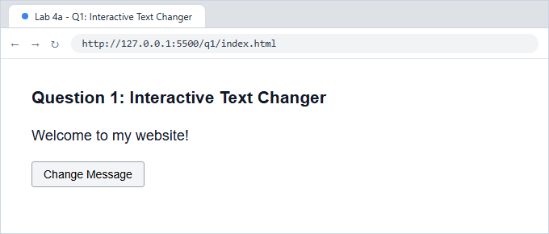
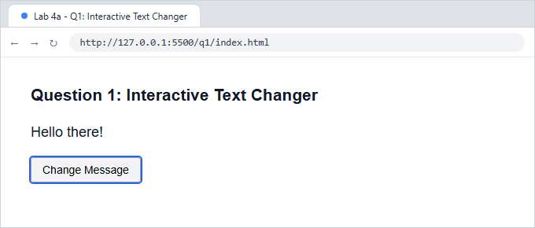
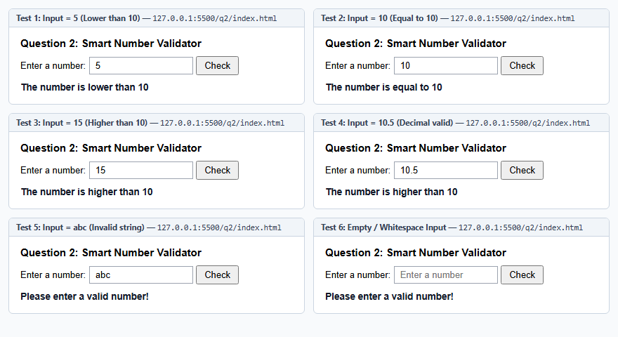
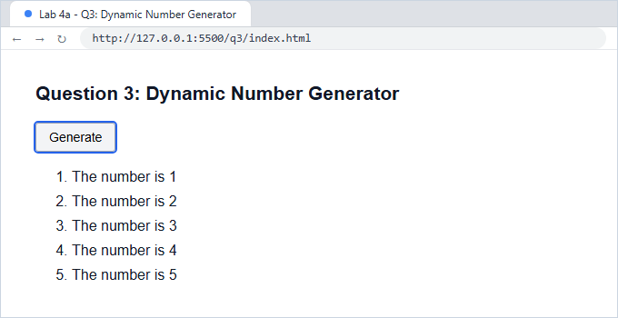

# BIC21203 Lab 4a: Client-Side Scripting (JavaScript)

- **Name:** Muhammad Imran Hakim Bin Zulkifli
- **Matric No:** CI250136
- **Course:** BIC21203 Web Development (Section 2)

## Overview
This repository contains my solutions for Lab 4a using HTML5 and client-side JavaScript:
- **Question 1 (`q1/`):** Interactive Text Changer — uses `getElementById()`, a `changeMessage()` function, `textContent`, and `addEventListener("click", ...)` to change the paragraph message to `"Hello there!"` when the button is clicked.
- **Question 2 (`q2/`):** Smart Number Validator — uses `checkInput()`, `.trim()`, `Number()`, `isNaN()`, and an `if...else if...else` statement to validate user input and compare numbers against `10`.
- **Question 3 (`q3/`):** Dynamic Number Generator — uses `generateNumbers()`, a `for` loop (`1` to `5`), `document.createElement("li")`, and `appendChild()` to build an ordered list while clearing previous items first so repeated clicks do not duplicate the list.

## How to Run
1. Clone or download this repository.
2. Open the folder in VS Code (or any browser).
3. Open `q1/index.html`, `q2/index.html`, or `q3/index.html` in a desktop web browser (or right-click and choose **Open with Live Server**).

## Screenshots
### Question 1: Interactive Text Changer
**Before click:**

**After click:**

### Question 2: Smart Number Validator

### Question 3: Dynamic Number Generator

